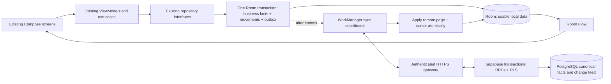

# Offline-first synchronization upgrade design

Status: proposed design following the Stage 1 audit. None of the protocol/schema/authorization features below is implemented by the audit commit. The existing release stays usable offline. Owner confirmed no Supabase project and only test/demo data; Live should begin as an empty organization, with test data retained separately.

## Retained architecture

Checkout has no dependency on a successful network request. Scheduling follows the local commit; a crash before scheduling leaves a durable outbox row discoverable on restart. Reads, barcode resolution, receipts, printing and reports use local records. Constructor injection remains in `AppContainer`; add gateway/coordinator/credential interfaces for testing. Keep the single app module and current branding/UI.

## Stage 2 — local database preparation

1. Keep all existing primary/foreign keys and historical snapshots. Add a migration after version 6; do not rebuild core tables to change their primary key type. Use companion identity rows mapping `(entity_type, canonical_local_key)` to a UUID, with unique constraints in both directions. Composite local keys need canonical, unambiguous encoding.
2. Use UUIDs for organization, canonical shops/products/barcodes, sale/return/item/movement/expense/audit identities and operations. Existing request UUIDs remain stable; older nullable requests receive stable mappings without rewriting historical receipt identities. UUID generation/identity backfill must be transactional and restart-safe.
3. A selected authoritative import receives a server-assigned dataset namespace and import manifest; deterministic legacy-ID mappings are valid only inside that namespace. Never derive globally shared product IDs from the shop code, SKU or barcode alone. New local records use random UUIDs. Detect copied datasets; do not blindly assign fresh sale identities on every phone.
4. Add local sync organization/device binding, entity versions/shadow state, outbox, upload-attempt/error state, pull checkpoint, canonical stock projection, conflict/reconciliation records and bootstrap/import metadata. No credentials in portable Room business tables. Extend backup format and validation in the same deliverable so new identities/pending events are not lost.
5. Local business writes create their serialized, immutable operation and all dependent IDs inside the SAME Room transaction. Enumerate every mutation from `AUDIT.md`, including manufacturer barcode deletions, expense voids, implicit cost-key creation, opening stock, labels and receipt footer changes. Do not implement sync by asynchronously observing audit/timestamp rows.
6. Source device identity/key is installation-bound and cannot be cloned in a backup. A replacement installation must enroll with a new device identity. Historical source IDs stay on records; recovery of pending events keeps original operation IDs/payload hashes and uses an owner-approved recovery manifest, not a forged old device key.
7. Preserve existing SKU/receipt numbers. After enrollment allocate compact, unique device codes on the server, for example future `OP-S-A7K2-000001`, `OP-R-A7K2-000001`, `OP-A7K2-000001`. Validate legacy and new reference formats together. Device code uniqueness and sequence high-water rules must survive restore; replacement devices get a new code. Check the existing barcode/label size bounds before fixing the final format.

Stage 2 acceptance: every historical 1–6 database upgrades on copies without changing existing business rows, local IDs, totals, snapshots, barcode values or receipt numbers; identity/outbox uniqueness, rollback and process-restart tests pass; legacy encrypted backups restore with safe new sync state; no background network is enabled merely by migrating schema. Never ship a populated identity/outbox schema with a backup exporter that silently omits it.

## Stage 3 — Supabase schema and authorization

Proposed canonical tables, all organization-scoped and indexed:

| Group | Tables / constraints |
| --- | --- |
| Access | `organizations`, `organization_memberships`, `shop_permissions`, `registered_devices`, device/session bindings and revocation history |
| Catalog | `shops`, `products`, `product_barcodes`, `shop_products`, `cost_code_settings`, `product_labels`, shared receipt profiles |
| Transactions | `sales`, `sale_items`, `returns`, `return_items`, `expenses`, append-only audit events |
| Stock | immutable `inventory_movements`, signed consolidated balance projection, discrepancy/reconciliation entries |
| Protocol | `sync_operations` (inbox/idempotency), immutable `sync_changes`, device checkpoints/acks, conflict records |
| Import/recovery | import manifests/staging and legacy mappings; bootstrap manifests; recovery requests and decisions |

Use UUID primary keys and composite foreign keys/uniques that enforce organization/shop/item lineage, not only application assertions. Barcode values are unique per organization. Sale/item/refund monetary values are PostgreSQL integer paise with checked bounds; snapshots are immutable. Do not accept arbitrary generic row upserts for financial records. Only explicit versioned RPC operations can mutate them.

Server RPC transaction order: derive authenticated user/session → verify enrolled device/session/key and current membership/shop permissions → lock organization change counter → check operation ID/payload fingerprint → validate operation/business dependencies and versions → write complete business bundle/ledger/conflicts → append change events/advance counter → commit → return durable acknowledgement. Repeating an identical operation returns its original result. Reusing an ID with different payload is rejected and audited. Idempotency lookup is not performed before caller authorization.

Product and price edits carry their expected server revision. A stale edit becomes a conflict with both original and proposed values. Owner/authorized manager resolves it with an explicit command against the current revision. Never last-write-wins prices, amounts, sale identities or movements. Barcode collisions must not silently merge products: retain the conflicting proposal and dependent financial operation for owner resolution; keep historical snapshots immutable.

### Commit-safe incremental changes

Do not use `updated_at` alone, and do not assume a bare PostgreSQL `BIGSERIAL` is commit-ordered. An early transaction can allocate sequence 10, commit after sequence 11, and be skipped by a client that already checkpointed 11.

For this small retail workload, serialize change allocation per organization using a counter row locked BEFORE business mutations and held until commit. Reserve monotonically increasing change numbers transactionally under that lock, with a unique `(organization_id, change_sequence)` index. Rollback rolls back the counter/events. All mutation/import/admin-permission paths that publish changes follow the same lock order. No bypassing direct client DML is permitted. This yields a clear safe publication order at an acceptable throughput for a few cashier devices.

Pull pages use an exclusive after-cursor and a stable upper watermark, with explicit next cursor and `hasMore`. The server must handle sequences invisible to a particular shop scope without silently stopping or looping on empty pages. Each event includes immutable operation/entity identity, revision, scope and a post-image or tombstone. Changes in permissions increment a scope epoch and require a new authorized snapshot, not continuation of a checkpoint created for another grant. Retention must explicitly reject an expired cursor and require bootstrap; never return an apparently successful empty delta after deleting required history.

Bootstrap uses a consistent, paginated snapshot manifest bound to organization, grant scope and watermark. Store immutable snapshot pages or replay a retained, immutable seed/change log to that watermark. Paging live tables with timestamps while other devices write is not a consistent bootstrap. Verify page counts/hashes/dependencies before atomically exposing the local dataset; then pull later changes.

### Authentication and permissions

Use Supabase Auth for enrollment and online refresh. APK configuration contains only the project URL/public publishable key. Publishable keys identify the client, not an authorized human. Never embed secret/service-role/database/admin credentials in Android or GitHub source.

Bind each enrolled device to the authenticated user's server-verified session and an installation-bound Android Keystore key/proof of possession. A body/header `device_id` alone cannot enforce revocation because a caller could substitute another ID. Validate authenticated session/device binding on every read/pull and write/RPC, including while the access JWT remains valid after revocation. Explicitly define session refresh/re-enrollment; do not bind devices by `auth.uid()` alone.

Enable RLS for exposed tables; deny anonymous business reads/writes; scope authorized selects by membership, shop and device/session state. Revoke direct client DML for ledger/financial/control tables. Grant narrowly scoped function execution only. Security-definer RPCs must qualify objects, constrain `search_path`, validate the actor internally, and never accept arbitrary SQL/table names. Owner setup and membership/device administration use a trusted server/administrator context. Client-supplied roles and user-editable profile metadata never grant access.

Proposed permissions: Owner administers both shops/devices/imports/conflicts/backups; Cashier can operate assigned shops with bounded sale/return permissions; Manager is reserved and denied until its explicit capability set is implemented. Product/price/adjustment/expense-void/return and purchase-cost visibility need an explicit capability matrix. Existing private cost display remains useful but is not a security boundary.

For offline operation, store the last verified, device-bound authorization grant and refresh credentials encrypted with Android Keystore, require a local unlock in synchronized mode, and enforce cached shop/capability rules at repository command boundaries. A local PIN alone must not create an authorization grant. Normal JWT expiry while disconnected must not disable an already provisioned cashier's permitted offline operations. Define continuity/grace and clock-tampering behavior separately from short-lived online JWT validation.

Revocation takes effect when contact resumes. Truly disconnected devices cannot be remotely wiped or instantly notified. Never claim local PIN/Keystore encrypt the entire existing SQLite database; Android's app sandbox/device storage protections still matter. Reject/quarantine revoked-device submissions rather than trusting their timestamps, retain pending local records, and provide an owner-reviewed recovery path. Public signup is not organization membership; owner invitations/enrollment authorize actual access.

Stage 3 acceptance: repeatable cloud migrations on a disposable project, tested RLS/RPC permissions for two organizations and shop scopes, no anonymous access, device-ID substitution/revocation tests, idempotency/rollback/sequence-order tests, successful owner enrollment and independent encrypted cloud backup restore. No project has yet been created or deployed.

## Stage 4 — durable synchronization engine

Add interfaces for authenticated transport, secure credentials, repository outbox access and scheduling; retain test doubles. Verify compatible stable WorkManager/HTTP dependencies before pinning them; do not invent versions or force a Kotlin/Compose rewrite to adopt a different SDK.

The worker uploads bounded batches in dependency order, distinguishes transient transport failures from permanent validation/permission/conflict outcomes, and pulls durable pages. Persist attempt/error state; use exponential backoff with jitter for transient failures and a manual retry for actionable failures. A conflict in one catalog operation must not indefinitely block unrelated valid transactions. Do not drop financially important failed operations or replay them with new IDs.

Apply each pull page and checkpoint in one Room transaction under the write gate. Resolve canonical UUIDs to stable local IDs before children. Preserve optimistic local edits through shadow/base revisions; expose concurrent changes for review. Repeated pages are idempotent. If an upload commits but its acknowledgement is lost, retry the same operation ID and reconcile echoed identities before changing stock again. Acknowledgements and pull echoes must not double-count a pending movement.

Use connected one-time work after commits/startup/resume/manual Sync Now, plus constrained periodic WorkManager work. Coalesce safely, e.g. a bounded `APPEND_OR_REPLACE` chain and a single coordinator, with a final durable pending-work check. Plain `KEEP` can lose a wake-up if another operation commits as a running worker exits. Periodic/startup recovery remains necessary if the process dies between commit and scheduling. Enqueue on network availability and respect Android backoff/Doze restrictions; no polling or restart loops.

Periodic work is not an exact timer; its minimum interval is 15 minutes. Android force-stop prevents normal background execution until the user reopens the app; do not promise immediate upload while force-stopped. Durable pending work must remain present across that boundary. Realtime can request a pull but cannot replace checkpoints/history.

Stage 4 acceptance: fake-transport crash/retry tests, transaction rollback fault injection, and actual independent Android local databases communicating with the same test backend; all A–I scenarios pass before production enablement.

## Inventory policy

Canonical stock is the sum of unique accepted movements. Authoritative history is imported once; do not add current stock as a second opening movement on top of the complete imported ledger. Preserve origin-device `quantityAfter` as an audit snapshot, not a globally authoritative total.

For each local product, project signed acknowledged movements plus not-yet-acknowledged unique local deltas, deduplicated by movement/operation UUID. Keep the signed balance and deficit explicitly in sync inventory state. Existing nonnegative availability can be a derived sellable amount, with an inventory discrepancy visible when signed balance is negative; clamping without retaining the deficit is prohibited.

Example: one canonical opening movement +10, A sale -3 and B sale -2 converge to 5 after any retry/order. If both sell the last unit, retain both genuine sale bundles and both debits; consolidated balance -1 creates an owner-visible discrepancy. Subsequent reconciliation is a new reasoned/audited movement, never deletion or modification of an original sale. Derived reports count each immutable sale/refund once.

## Refund policy decision required before multi-device enablement

Server transactions lock original sale items, validate existing cumulative returned quantities, and recompute exact discounted refund rights. Preserve the current Hamilton/per-unit allocation and paisa conservation.

There is no algorithm that guarantees every disconnected device can cash-refund the same last remaining unit while also guaranteeing no excess total cash refund. Two supported design choices must be resolved explicitly:

1. Reserve offline return/refund rights to a device or quantity allowance; cross-device rights transfer requires online authorization. This strictly prevents excess valid refunds but limits which offline device can finalize a particular refund.
2. Record permitted offline cash payouts provisionally. If the server detects exhausted original-sale rights, retain the genuine payout as a reconciliation exception/cash outflow, not a second valid canonical return or an erased record. Quarantine disputed restock until the owner resolves it. Show provisional status in staff history/reports and provide an honest refund receipt immediately. The customer cannot be assumed to repay already handed-over cash.

The second option better preserves the requested unrestricted offline recording, but requires acceptance of possible reconciliation. This audit does not silently select or implement it. Until decided/tested, multi-device production refund finalization remains disabled by the future rollout gate. Offline sales remain an independent local transaction.

## Stage 5 — existing interface integration

Add a small app-bar status icon and a Settings synchronization page: standalone/not provisioned, synced, offline, pending, syncing, error and conflict. Derive status from durable queue/checkpoint/conflict/auth state, not a connectivity callback alone. A disconnected device cannot claim to know it has every other device's latest sale; describe the last successful exchange and locally known pending state accurately.

Show last successful exchange in Pakistan time, pending count, Sync Now and readable error details. Keep business views local and update through Room Flow. Catalog conflict resolution and negative consolidated stock need functional staff UI, not raw JSON or implementation details. Preserve the barcode capture, staff-profit privacy, receipt QR/printing, dedicated returns section, layout controls and shop separation.

A new device must state that it does not know the shop's existing inventory until initial provisioning completes. If it has existing standalone records, require an owner-reviewed import decision rather than overwriting or silently merging. Offline local unlock is supported after provisioning without re-authenticating over the network at each launch.

## Restore, migration and independent backups

See `BACKUP_AND_TEST_PLAN.md`. Routine schema upgrades are additive; full database restore remains an explicit, verified owner operation. A synced-device restore is not a command to replace cloud history or republish an old database under new sale IDs. Restore into staging, verify lineage/fingerprints, compare with cloud/import manifest, recover unique unsent events under an owner process, and re-provision device authorization/checkpoints before live use. Current writer epoch/data-generation safeguards remain in force.

Keep local encrypted backups independent of sync. Owner cloud backups must include canonical business data, mappings, operation deduplication and sequences required for replay safety; credentials remain separate. Schedule an encrypted, independently retained server-side export, verify completion/integrity, retain known-good generations, and perform isolated restore drills. Supabase-managed backups/retention depend on the selected plan and do not replace an off-service recovery copy. This backup service is future work, not an existing capability.

## Stage 6 — rollout gate

Run the A–J matrix and extra protocol/security/restore cases in `BACKUP_AND_TEST_PLAN.md`. Pin tested dependency versions and cloud migration checksums. Produce a retained-key signed upgrade and test in-place installation on a copy of every supported schema/signing lineage. Start with separate Demo/test project and two isolated devices; enroll an empty Live business only after reconciliation, permissions, backup restore and actual multi-device tests succeed. Preserve the current release/checkpoint and recovery instructions throughout.

## Official platform references checked during audit

- [Supabase RLS](https://supabase.com/docs/guides/database/postgres/row-level-security) — enforce access at the database boundary.
- [Supabase API keys](https://supabase.com/docs/guides/getting-started/api-keys) — public client keys versus privileged server secrets.
- [Supabase sessions](https://supabase.com/docs/guides/auth/sessions) — distinguish expiring access JWTs, refresh and device/session authorization.
- [Supabase backups](https://supabase.com/docs/guides/platform/backups) — verify available backup/restore coverage in the chosen plan.
- [Android WorkManager requests](https://developer.android.com/develop/background-work/background-tasks/persistent/getting-started/define-work) — network constraints, periodic scheduling and retry/backoff.

These references establish platform behavior; the transaction, counter-locking, identity, conflict and recovery design above is specific to this application and still requires implementation/testing.
